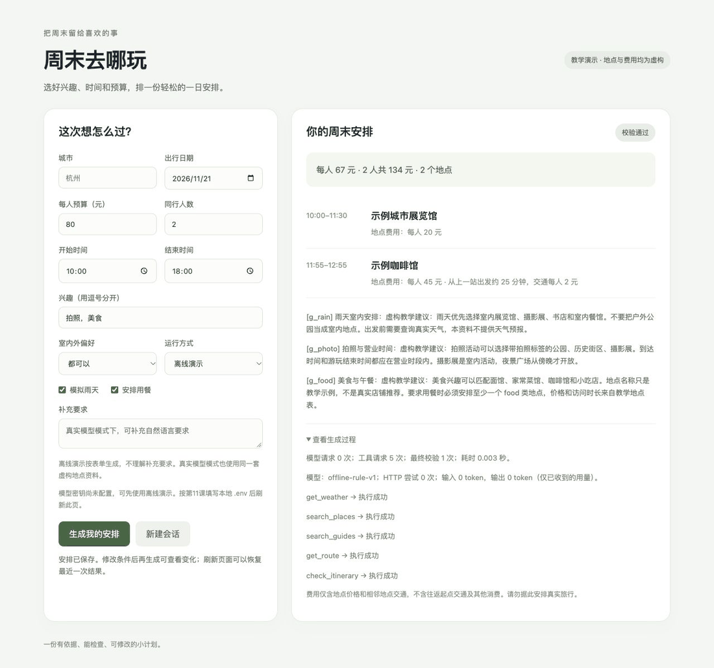

# 周末去哪玩

一个可运行的城市一日游 Agent：自然语言或表单输入 → 工具调用 → 资料检索 → 最终约束校验 → 网页展示 → 会话保存。

Python 3.11 以上，**只用标准库，零第三方运行依赖**，核心代码约 2700 行。

**全部地点、天气、费用、路线和资料均为虚构教学数据。**



> 界面预览为 v0.3.0 版本；当前版本已增加「解析这句话」自然语言入口与历史记录列表。

## 真实模型实测结果

2026-10-04/05，DeepSeek `deepseek-flash`（V4.1-Flash），非思考模式。原始报告与调用 trace 见 [reports/](reports/README.md)。

| 套件 | 数据集 | 真实模型 | 离线规则基线 |
|---|---|---|---|
| Agent 回归 | 12 例固定场景 | **12/12、12/12、12/12**；54–68 次请求；中位 6.6–7.5 秒 | 12/12，约 1 毫秒 |
| 槽位抽取 | 20 例口语化输入 | 准确率 **96.0%** · 幻觉误填率 **1.6%** · 追问正确率 **100%** | 不适用 |
| 引用评审 | 12 例方案引用 | 命中率 **70.4%** · 召回率 **95.0%** · 无关引用率 29.6% | 不适用 |
| 资料检索 | 201 篇 / 44 条标注查询 | BM25 recall@5 **67.0%** / MRR 0.706；TF-IDF 65.9% / 0.712 | 同（词法检索不依赖模型） |

三次 agent 回归**全部 0/12 触发修复轮、0/12 走文本兜底通道**——方案全部通过 `submit_plan` 工具提交。

## 检索：切片、稠密、融合、重排，以及四个诚实的结论

检索链路的四段（召回 → 融合 → 精排）都实现了，并用标注查询做了对照实验。**结论不是"全都有效"**：

| 方法 | recall@5 | MRR | 结论 |
|---|---|---|---|
| BM25 稀疏（基线） | 67.1% | 0.706 | 默认使用 |
| 二阶共现稠密（零外部依赖） | **11.0%** | 0.048 | ❌ 自造稠密后端无效 |
| 稀疏+稠密 RRF 融合 | 67.1% | **0.422** | ❌ 融合差路由会拖累排序 |
| 融合 + **LLM 精排** | **69.3%** | **0.750** | ✅ 唯一稳定有提升的环节 |

**四个结论都来自实测：**

1. **切片有效，但重叠的作用被误解了**。长文档语料上整篇检索 recall@5 58.2%；切片后 59.5%–63.9%，MRR 从 0.665 升到 0.716–0.727。但**重叠越多、recall 反而越低**——片段变多后 top-5 更容易被同一篇长文档的多个片段占满（30% 重叠时 32/44 条查询如此），去重后可覆盖的不同文档从 4.93 降到 3.95。
2. **因此必须「超额召回 + 父文档去重」**。加上后 30% 重叠的 recall 从 61.2% 回到 62.5%、MRR 保持 0.727——这是 `ChunkedIndex` 存在的理由。
3. **没有语义 embedding 时，自造稠密后端没有价值**。二阶共现（文档相似度矩阵的行作为稠密表示）独立召回只有 11.0%，作为 BM25 的补充只带来 MRR +0.011、召回完全不变。**生产路径必须接真正的 embedding API**。
   `ApiEmbeddingProvider` 已实现并**接进产品链路**：在 `.env` 填 `EMBED_BASE_URL` / `EMBED_API_KEY` / `EMBED_MODEL` 三项即启用「BM25 + 稠密」混合检索；**任一项缺失、后端故障、或语料不匹配都会自动降级回纯 BM25**，并把原因写进工具结果的 `retrieval_degraded` 字段——降级可见，不静默。
4. **融合的前提是每一路都够好**。RRF 按名次融合、不区分路由质量，把 11% 召回的稠密路由与 67% 的 BM25 等权融合，MRR 直接从 0.706 掉到 0.422。**"用了混合检索"本身不是加分项。**

LLM 精排是唯一稳定有收益的一环：44 条查询、44 次模型调用、56 秒，recall +2.3pp、MRR +4.4pp，且**没有一次编造候选之外的 ID**。

## 记忆：分层，而不是无限堆上下文

- **结构化事实**（零额外模型调用）：用户条件直接来自已校验的 `TripRequest`，按带时间戳的事实存下来；**冲突时新值覆盖旧值但保留历史版本**，可回溯"这个预算什么时候改的"。
- **滚动摘要**（需要一次模型调用，默认关闭）：把超出窗口的旧回合压缩成要点，让模型在不膨胀上下文的前提下仍知道更早的偏好与已排除方案。

分开的理由很直白：**为了"记住预算 200"去调一次模型，成本与延迟都不划算**——这本来就是结构化数据。

## 可观测性与安全

- **观测面板** `/trace`：成功率、中位/P95 耗时、token、工具调用直方图、失败归因分类、逐次运行的 event 时间线。失败归因按事件计数（终审被拒按通道分类），与"修复轮"方法论一脉相承。
- **提示注入防御**：检索内容是不可信的外部数据。`guard.py` 用 8 类规则扫描 + 定界符包裹（`<<<外部资料开始 id=...>>>`）把它标记成数据而非指令；命中只作标记与统计、**不改写正文**（改写会破坏检索质量）。红队集 15 条恶意样本全部命中、3 条负样本零误报、201 篇真实语料零误报。
  **但它挡不住语义改写、异体字与编码载荷**——我自己的 3 条新攻击样本全部绕过，且**没有为了迎合测试而放宽规则**（放宽会误伤"请不要忽略公园的开放时间规则"这类正常文本）。详见 [docs/GUARD.md](docs/GUARD.md)。

## 工具并行：实现了，但默认关闭

同一轮里互不依赖的工具可以并发。用合成的 0.3 秒慢工具验证机制有效：**0.92s → 0.31s（3 倍）**。但**真实工具是本地内存计算，5 个工具合计不到 1 毫秒**，实测并发反而更慢（7.46ms vs 6.66ms，线程调度开销超过收益）。因此默认关闭，只在接入外部慢工具（HTTP/RPC）时才值得打开。

## 最终交付走工具调用，不走文本

早期实现让模型把方案作为**普通文本**输出，应用再解析。真实评测显示这条路很脆：模型会把 JSON 包进 Markdown 围栏，或在 JSON 前面加一段解释文字，导致解析失败并多烧一轮完整上下文。第一次修复基于错误假设（以为只是围栏问题），只剥离围栏，**结果把同用例的修复轮从 5/6 改成了 6/6**；记录下被拒原文后才发现真因。完整排查过程见 [reports/README.md](reports/README.md)。

现在改为 `submit_plan` 工具调用：`arguments` 由接口保证是合法 JSON，**格式问题在结构上就不存在**。文本解析只作为兜底保留，是否被使用记录在 `RunResult.submitted_via` 上，可以直接度量——实测 0/12。

代价是终止条件变了（不再是"模型不再调用工具"），以及一个容易踩的坑：提交成功后必须给同批次里**所有** `tool_call` 补上配对结果，否则下一轮接口会直接拒绝。测试里有一条专门锁住这个行为。

## 让模型真正承重的那一步：自然语言 → 结构化条件（支持多轮追问）

```bash
python3 main.py --live --ask "这周六下午想带爸妈出去走走，人均一百五以内，最好能坐下吃个饭"
```

```text
还需要你确认：同行人数。补充之后我再生成安排。
你的补充： 一共三个人
从这句话抽取到的条件： {"travel_date": "2026-10-10", "budget_per_person": 150, "group_size": 3, "tags": ["散步"], "include_meal": true}
经过 1 轮补充后条件已齐全。
已合并进表单条件，开始规划。
10:00–11:00 示例河边步道
11:15–12:15 示例面馆
...
每人 86 元，全组 258 元。
```

模型在这里做三件不可替代的事：**把相对日期换算成 ISO 日期**、**把口语整理成可校验的槽位**、**对缺失的关键条件主动追问**。追问循环会把用户每次补充**并回完整描述**再重新抽取，模型始终看到全部上下文。

安全边界与终审同源：模型只负责**提出候选值**，写入 `TripRequest` 之前一律经过与表单**完全相同的校验器**。

网页上点「解析这句话」同样支持多轮：缺少条件时表单保留已确定的部分，输入框清空等待补充。

**幻觉误填率**是这一层最重要的指标——衡量"用户没说的条件，模型有没有自己编一个"，实测 1.6%。

## 架构：一次请求经过五层

```text
网页 / CLI（表单 或 一句自然语言）
  ↓
extraction.py          模型抽取槽位 → 与表单同一套校验 → 缺失则多轮追问
  ↓
PlanningService        会话锁 + 全局并发上限 + 权威约束合并
  ↓
TripAgent 循环         协议校验、轮数与调用上限、工具结果回灌
  ↕
ChatProvider           同一接口的两个实现：离线规则 | 真实模型
  ↓
ToolRegistry           5 个业务工具 + submit_plan + JSON Schema 参数校验
  ↓
verify_plan            用用户原始条件重算，模型说什么不算数
  ↓
SQLite + 网页 / CLI
```

五个关键设计：

- **两层校验**。`check_itinerary` 在规划途中给模型反馈；`verify_plan` 是应用终审，永远用表单里的预算和时间重算。
- **用户级约束在构造时注入**。雨天和用餐要求都是 `TripTools(rain=..., include_meal=...)`，**模型无法通过工具调用放宽约束**（Schema 会直接拒绝该字段）。
- **证据白名单**。最终方案的地点必须来自本轮 `search_places`，引用必须来自本轮 `search_guides`。
- **错误即数据**。工具异常转成 `{"ok": false, "error": ...}` 回灌给模型；无结果时还会带 `hint` 给出判决性提示，避免模型换参数反复空转（实测把该场景的工具调用从 17 次降到 5 次）。
- **失败原文要留证据**。终审被拒时记录被拒文本开头——这条观测缺口正是定位 JSON 缺陷的关键。

模块职责与取舍见 [docs/ARCHITECTURE.md](docs/ARCHITECTURE.md)。

## 快速开始

```bash
python3 main.py --serve          # 打开 http://127.0.0.1:8765
python3 main.py --demo           # 命令行离线演示
python3 main.py --demo --rain --budget 80
python3 main.py --demo --chat    # /budget 80 改预算，/rain 切雨天，exit 退出
```

网页可改预算、人数、时间、兴趣、雨天、室内外和用餐要求；可用一句话解析条件（支持多轮补充）；**生成过程通过 SSE 实时显示工具调用进度**；刷新或从历史列表恢复过去的生成结果。

## 接入 DeepSeek

项目自动读取根目录 `.env`，进程环境变量优先。

```bash
python3 main.py --doctor       # 不联网，只检查脱敏配置状态
python3 main.py --check-api    # 两轮真实请求，会消耗额度
python3 main.py --live --rain --budget 80
python3 main.py --live --ask "两个人，11月21号，预算200，想拍照"
python3 main.py --live --ask "预算500" --answer "11月21号" --answer "两个人"
```

`--answer` 可重复，用于脚本化地回答追问。默认关闭 thinking，输出上限 4096、超时 60 秒、最多重试 1 次。

**注意 `.env` 每行必须完整换行。** 曾出现两行粘连导致 `LLM_BASE_URL` 被并入 key 值、请求返回 401 的情况；本项目按第一个 `=` 切分，不会自动纠正这类错误。

## 验证与评测

```bash
PYTHONPATH=src python3 -m unittest discover -s tests -v   # 200 项，全部内存模拟响应，不联网
python3 main.py --evaluate                              # 离线规则回归
python3 main.py --evaluate --live                       # 真实模型回归
python3 main.py --evaluate --suite extraction --live    # 槽位抽取
python3 main.py --evaluate --suite citations --live     # 引用评审（LLM-as-judge）
python3 main.py --evaluate --suite retrieval            # BM25 vs TF-IDF，不联网
python3 scripts/build_corpus.py                         # 重新生成检索语料，固定种子、幂等
```

## 集成

**MCP 服务**（最小 stdio 实现，纯标准库）：

```bash
printf '%s\n' '{"jsonrpc":"2.0","id":1,"method":"initialize","params":{}}' \
  | PYTHONPATH=src python3 scripts/mcp_server.py
```

只暴露 5 个业务工具，按名字排除 `submit_plan`（复用 `tools.CONTROL_TOOLS`，避免两份名单分叉）。

**CI**：[.github/workflows/ci.yml](.github/workflows/ci.yml) 在 Python 3.11 / 3.13 上跑全部测试、离线回归、检索评测、语料幂等性，以及 MCP 服务的 stdout 纯净性。

## 已知边界

- 12 例回归是开发期小型集合、**不是盲测**；20 例抽取评测标签由作者人工标注；检索语料与标签**都由脚本生成**；引用评审是**模型评审模型**，且方案没有自由文本论证，测的是主题相关性而非严格语义蕴含。
- 检索是字符二元组 BM25，**没有 embedding 或向量库**。实测口语化近义词是词法检索的硬盲区（"胶卷" vs "胶片冲洗" 完全重叠为零）。
- 不保证填满 10:00–18:00；不处理起终点导航、实际票价、订票、跨城市或跨午夜。
- 会话保存完整已完成回合，最近三个完整回合进入模型上下文，**没有摘要压缩**；并发控制只在单进程内有效。
- 网页仅绑定 `127.0.0.1`，无账号鉴权，不应原样公开部署。
- MCP 服务是**最小子集**（initialize / tools/list / tools/call / ping），未实现 resources、prompts、sampling、取消与协议版本协商，**没有用真实 MCP 客户端验证过**。
- 当前**没有** LangGraph、向量库、真实地图、多 Agent、公网部署或线上用户。

### 三个已修复的缺陷（排查过程见 [reports/README.md](reports/README.md)）

1. **工具层给出假绿灯**：`check_itinerary` 曾不检查用餐要求而 `verify_final` 检查，两层口径不一致导致模型连续三次终审失败。修复为把 `include_meal` 与 `rain` 一样在构造时注入。
2. **最终输出不是干净 JSON**：第一次修复只剥 Markdown 围栏（假设错误，把修复轮从 5/6 变成 6/6）；记录被拒原文后改为提取第一个配平的 JSON 对象，修复轮降为 0/6；最终进一步改为 `submit_plan` 工具调用，从结构上消除该问题。
3. **无解场景空转**：模型在"要求用餐但预算内没有餐厅"时反复换参数搜索，耗尽工具调用额度。修复为在无解时返回判决性 `hint`，工具调用从 17 次降到 5 次。

## 核心文件

```text
src/weekend_agent/
  request.py         表单权威条件
  extraction.py      自然语言 → 槽位抽取 + 多轮追问
  tools.py           5 个业务工具 + submit_plan + Schema 与参数校验
  retrieval.py       字符二元组 BM25
  retrieval_eval.py  TF-IDF 基线与 recall@k / MRR
  jsonio.py          模型输出的容错 JSON 解析
  config.py          .env、环境变量及调用限制
  diagnostics.py     离线配置检查与两轮 API 连通测试
  providers.py       模型 API 适配与早期固定演示
  planning.py        多站离线规则流程
  agent.py           消息循环、调用护栏、submit_plan 终审通道
  finalize.py        最终方案校验与应用渲染
  memory.py          SQLite 会话、上下文选择与生成快照
  longterm.py        结构化事实记忆 + 滚动摘要（冲突更新）
  chunking.py        长文档切片 + 按父文档去重的片段检索
  embedding.py       可插拔向量后端（API / 零依赖二阶共现）
  hybrid.py          稠密索引 + RRF 融合 + LLM 精排
  guard.py           提示注入扫描与外部数据定界
  stats.py           跨运行聚合与失败归因
  service.py         会话和业务组装
  server.py          仅本机 HTTP 服务（含 SSE 进度流）
  evaluation.py      固定回归、弱基线与修复轮统计
  extraction_eval.py 抽取准确率 / 幻觉误填率 / 追问正确率
  citation_eval.py   引用命中率 / 召回率（LLM-as-judge）
  web/               HTML、CSS、JavaScript
  data/              虚构地点、资料与评测用例
scripts/build_corpus.py      确定性生成检索语料与标注查询
scripts/build_long_corpus.py 生成用于验证切片的长文档语料
scripts/mcp_server.py        最小 MCP stdio 服务
reports/           真实模型评测报告与调用 trace
docs/              架构设计、本机使用说明、验证状态
tests/             业务、协议和集成测试（200 项）
assets/            界面截图
```

完整设计与取舍见 [ARCHITECTURE.md](docs/ARCHITECTURE.md)，本机网页与数据库说明见 [LOCAL_WEB.md](docs/LOCAL_WEB.md)，验证状态与已知局限见 [STATUS.md](docs/STATUS.md)。

## 说明

本项目为个人学习作品，地点、天气、价格与资料**全部为虚构教学数据**，不构成真实旅行建议。代码由作者在 AI 辅助下完成并逐项实测验证；所有评测数字来自 `reports/` 中的原始报告，未做修饰。

学习过程中使用的课程讲义、分课脚本与面试题库保存在本地 `notes/` 目录，**不纳入本仓库**。

以 MIT 许可证开源，见 [LICENSE](LICENSE)。
