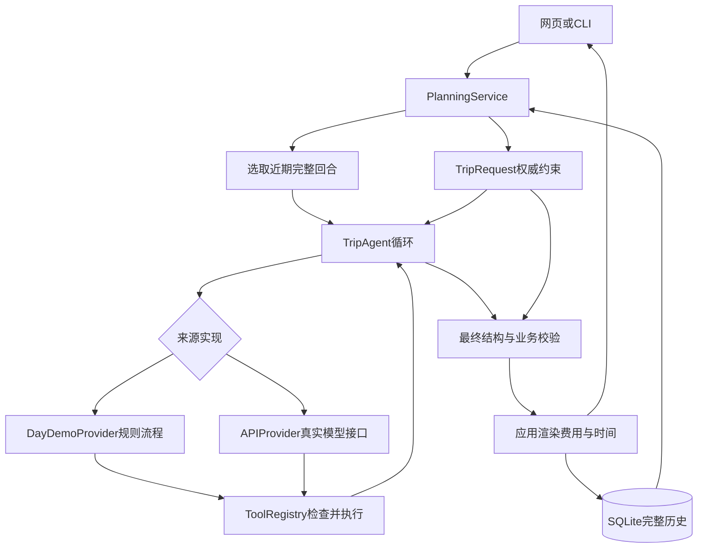

# 架构与设计取舍

更新：2026-10-04，版本0.3.0。这个版本是可运行的本地学习作品，含离线规则流程及真实模型适配器。所有地点、天气、路线与资料均为虚构教学数据。

## 数据怎样走

## 模块职责

| 模块 | 保存或处理什么 | 不应负责什么 |
|---|---|---|
| request.py | 用户表单的权威预算、人数、时间、兴趣 | 让模型自行放宽限制 |
| tools.py | 五个工具、参数规则与业务校验 | 网页排版、模型HTTP |
| retrieval.py | 中文字符二元组和BM25词法排序 | embedding训练或向量库 |
| providers.py | 模型接口和早期固定演示来源 | 业务预算计算 |
| planning.py | 多站离线规则规划和工具请求模拟 | 自由文本理解或模型能力证明 |
| agent.py | 消息循环、协议检查、调用上限 | 信任模型填写的最终价格 |
| finalize.py | 来源ID、用户条件、最终费用校验与渲染 | 验证资料是否符合现实 |
| memory.py | SQLite完整记录与近期上下文选择 | 跨会话语义长期记忆 |
| service.py | 组装对象、恢复条件、会话锁与保存 | 修改模型内部参数 |
| server.py / web/ | 本地HTTP与界面 | 公开账号系统或密钥存储 |
| evaluation.py | 固定回归场景和弱基线 | 自动证明真实模型泛化 |

## 为什么单Agent和标准库

业务规模小，工具都是本地读取与计算。直接展示循环有助于学习协议、变量与错误处理，不必同时学习框架抽象。多个Agent会增加状态同步和调用成本，目前没有实验显示必要性。

如果迁移LangGraph：State可以包含messages、request、place_ids、guides；模型请求、工具执行、最终校验分别是Node；按tool_calls和校验结果设置条件Edge。检查点恢复执行位置与当前SQLite保存完整已完成回合是不同能力。**当前没有实现LangGraph或MCP。** 图式状态、工具调用和流程区别参考 [LangGraph官方文档](https://docs.langchain.com/oss/python/langgraph/workflows-agents)。

## 两层校验为什么都存在

工具的check_itinerary可在规划途中给模型反馈。最终verify_final重新使用TripRequest中的用户条件计算，避免模型把预算参数改成999后拿“已通过检查”作为超预算方案依据。

最终结构不允许价格和名称字段；应用从地点表重算并渲染。地点ID必须来自本轮搜索，引用ID必须来自本轮检索。来源存在检查不等于引用内容支持某个结论，语义忠实性还需人工或独立评测。

## 状态与并发边界

完整历史留在SQLite，模型最多取最近三个完整结构化回合并受40000字符上限限制；字符不是token。一轮太大时明确拒绝，不拆开工具请求与结果。当前没有摘要压缩。

同会话锁阻止同进程重复生成，version更新防止旧数据覆盖，全局最多两个任务。这些不是分布式锁。数据库保存完成回合，不提供工具节点中间断点恢复。

网页只绑定127.0.0.1，检查本地Host与Origin。没有账号鉴权，不应原样公开部署。API密钥读取环境变量或被Git忽略的根目录.env，不进入浏览器、SQLite或trace；默认DeepSeek使用非thinking模式，内部推理字段不保存。

## 作品的实际范围

能展示多站计划、雨天室内、预算重排、资料引用、完整会话恢复、工具轨迹与回归报告。不保证把10:00–18:00填满，不处理起终点导航、实际票价、订票、跨城市或跨午夜。

离线规划是贪心规则，可能漏掉可行解。no_plan只表示没有找到候选，不能断言全局无解。真实模型适配器已做模拟协议验证，真实模型质量仍待接入后测量。

## 模型接入与失败观测

ModelConfig按进程环境优先、项目.env其次读取配置；配置对象repr不展示密钥，网页健康检查仅使用public_info。doctor不联网；check_api用两轮请求验证一次天气工具调用与结果回传。

APIProvider对输出截断先停止，不执行半截参数；错误按HTTP状态分类，429、5xx与网络异常使用有上限的退避。逻辑模型轮次与http_attempts分开记录。PlanningError携带失败前计数，评测汇总失败任务的请求与已收到usage；响应丢失时账单可能高于观测用量。

官方DeepSeek仍固定非thinking模式；当前历史去除reasoning_content，因此尚不支持开启thinking后跨回合保存该协议字段。接入说明及官方依据见第11课。
